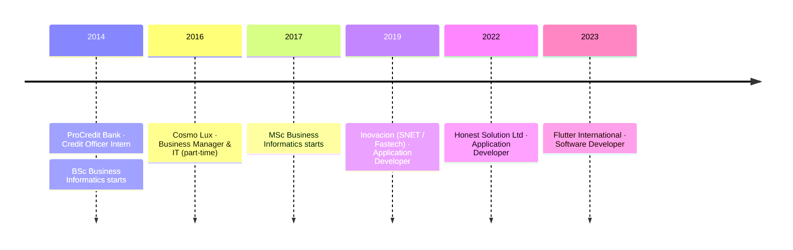

<!-- ═══════════════════════════ HEADER ═══════════════════════════ -->

<p align="center">
  
</p>

<p align="center">
  <a href="https://github.com/Jurgest">
    
  </a>
</p>

<p align="center">
  <a href="https://jurgest.com"></a>
  <a href="mailto:jurgestballa@gmail.com"></a>
  <a href="https://linkedin.com/in/jurgest-balla-24601"></a>
  
</p>

<br/>

<!-- ═══════════════════════════ AT A GLANCE ═══════════════════════════ -->

<table align="center">
  <tr>
    <td align="center" width="160"><h2>7+</h2><sub>years building<br/>production software</sub></td>
    <td align="center" width="160"><h2>3</h2><sub>software companies<br/>since 2019</sub></td>
    <td align="center" width="160"><h2>9</h2><sub>product areas, FinTech<br/>to Healthcare to AI</sub></td>
    <td align="center" width="160"><h2>Web + Mobile</h2><sub>React & React Native<br/>iOS · Android · Web</sub></td>
  </tr>
</table>

## 👨‍💻 About Me

I'm a **Full Stack Developer** who takes products from first sketch to production and keeps them healthy afterwards. I build with **React, React Native, Node.js, NestJS and TypeScript**, design **GraphQL & REST APIs**, and ship on **AWS, Firebase and serverless** platforms, with CI/CD, Docker and automated tests set up along the way.

I've worked on **FinTech, Healthcare, E-Commerce, SaaS and HR** products, and I often take on the problems that sit between frontend and backend. I care about clean, modular code, security, accessibility and a user experience that feels fast.

```ts
const jurgest = {
  role:        "Software Developer @ Flutter International",
  location:    "Tirana, Albania 🇦🇱",
  website:     "https://jurgest.com",
  focus:       ["Full stack web & mobile", "API design", "AI-powered features"],
  learning:    ["Kubernetes", "Terraform", "Advanced DevOps"],
  languages:   { english: "fluent", italian: "conversational" },
  openTo:      "ambitious, high-impact collaborations",
};
```

<!-- ═══════════════════════════ TECH STACK ═══════════════════════════ -->

## 🧰 Tech Stack

<table>
  <tr>
    <td width="170"><b>🎨 Frontend</b></td>
    <td>
      
      <br/>
      
      
    </td>
  </tr>
  <tr>
    <td><b>📱 Mobile</b></td>
    <td>
      
      <br/>
      
      
      
    </td>
  </tr>
  <tr>
    <td><b>⚙️ Backend</b></td>
    <td>
      
      <br/>
      
      
      
    </td>
  </tr>
  <tr>
    <td><b>🤖 AI & Data</b></td>
    <td>
      
      
      
      
      
      
    </td>
  </tr>
  <tr>
    <td><b>🗄️ Databases</b></td>
    <td></td>
  </tr>
  <tr>
    <td><b>☁️ Cloud & DevOps</b></td>
    <td>
      
      <br/>
      <sub>AWS: Lambda · API Gateway · S3 · DynamoDB · CloudWatch · EC2 · serverless apps</sub>
    </td>
  </tr>
  <tr>
    <td><b>🛠️ Tools & Testing</b></td>
    <td></td>
  </tr>
  <tr>
    <td><b>🌱 Learning now</b></td>
    <td></td>
  </tr>
</table>

<!-- ═══════════════════════════ EXPERIENCE ═══════════════════════════ -->

## 🚀 Career Journey



<details open>
<summary><b>💼 Software Developer · Flutter International</b> &nbsp;<sub>May 2023 – Present · Tirana</sub></summary>
<br/>

- Build scalable full stack web and mobile apps with **React, React Native, Node.js, NestJS and Express.js**
- Integrate **REST and GraphQL APIs** with secure auth (**JWT, RBAC**)
- Run **CI/CD pipelines** with GitHub Actions and Jenkins for automated testing and deployment
- Deploy on **AWS** (Lambda, API Gateway, S3, DynamoDB) and **Firebase**
- Build **AI-powered features** with Python (FastAPI, LangChain, Hugging Face) and vector databases

</details>

<details>
<summary><b>💼 Application Developer · Honest Solution Ltd</b> &nbsp;<sub>Oct 2022 – May 2023 · Tirana</sub></summary>
<br/>

- Built modern, responsive web apps with **React, Next.js and TypeScript**
- Designed and maintained backend services with **Node.js, NestJS and Express.js**
- Improved system performance by optimising APIs and database queries
- Delivered features with cross-functional teams in Agile sprints

</details>

<details>
<summary><b>💼 Application Developer · Inovacion (SNET, part of Fastech)</b> &nbsp;<sub>May 2019 – Oct 2022 · Tirana</sub></summary>
<br/>

- Designed and developed responsive web apps with **React.js, Redux and Next.js**
- Built secure backend APIs with **Node.js and Express.js**, integrating **MongoDB and GraphQL**
- Deployed on **AWS** (EC2, S3, Lambda) following SaaS principles
- Contributed to architecture decisions for scalability, maintainability and reliability

</details>

<details>
<summary><b>📁 Earlier roles</b></summary>
<br/>

- **Business Manager & IT (part-time)**, Cosmo Lux shpk · Jan 2016 – Jul 2021: international sales, supplier relations, IT infrastructure, web development and support
- **Credit Officer Intern**, ProCredit Bank · Jan – May 2014: loan application analysis and credit risk assessment

</details>

<!-- ═══════════════════════════ PROJECTS ═══════════════════════════ -->

## 🧩 What I've Built

<table>
  <tr>
    <td width="33%" valign="top">
      <h3>🤖 AI-Powered Tools</h3>
      Chatbots and recommendation engines for automation and intelligent search.
      <br/><br/>
      <sub><code>Python</code> <code>FastAPI</code> <code>LangChain</code> <code>OpenAI</code></sub>
    </td>
    <td width="33%" valign="top">
      <h3>💳 FinTech Apps</h3>
      Secure payment workflows, financial dashboards and transaction management.
      <br/><br/>
      <sub><code>React</code> <code>NestJS</code> <code>AWS</code></sub>
    </td>
    <td width="33%" valign="top">
      <h3>🏥 Healthcare Platforms</h3>
      HIPAA-aligned patient management tools focused on data security and compliance.
      <br/><br/>
      <sub><code>React</code> <code>Node.js</code> <code>GraphQL</code></sub>
    </td>
  </tr>
  <tr>
    <td valign="top">
      <h3>💬 Social Networking App</h3>
      Cross-platform mobile & web app with real-time chat and interactions.
      <br/><br/>
      <sub><code>React Native</code> <code>Firebase</code> <code>WebSockets</code></sub>
    </td>
    <td valign="top">
      <h3>🛒 E-Commerce & Ordering</h3>
      Responsive storefronts and mobile ordering apps with online payments.
      <br/><br/>
      <sub><code>Next.js</code> <code>Stripe</code> <code>Firebase</code></sub>
    </td>
    <td valign="top">
      <h3>🎫 Ticketing System</h3>
      Helpdesk platform with notifications and real-time updates.
      <br/><br/>
      <sub><code>NestJS</code> <code>GraphQL</code> <code>React</code></sub>
    </td>
  </tr>
  <tr>
    <td valign="top">
      <h3>📂 Document Management</h3>
      Secure file management for enterprise document workflows.
      <br/><br/>
      <sub><code>AWS S3</code> <code>DynamoDB</code> <code>Express.js</code></sub>
    </td>
    <td valign="top">
      <h3>🧑‍💼 ATS & HR Tools</h3>
      Applicant tracking with resume parsing and advanced search.
      <br/><br/>
      <sub><code>React</code> <code>Node.js</code> <code>MongoDB</code></sub>
    </td>
    <td valign="top">
      <h3>📝 CMS Platform</h3>
      Content management with role-based access and multilingual support.
      <br/><br/>
      <sub><code>React</code> <code>Node.js</code> <code>PostgreSQL</code></sub>
    </td>
  </tr>
</table>

<!-- ═══════════════════════════ STATS ═══════════════════════════ -->

## 📈 GitHub Activity

<p align="center">
  <picture>
    <source media="(prefers-color-scheme: dark)" srcset="https://streak-stats.demolab.com?user=Jurgest&theme=tokyonight&hide_border=true&background=0D1117&ring=06B6D4&fire=06B6D4&currStreakLabel=06B6D4"/>
    
  </picture>
</p>

<!-- ═══════════════════════════ EDUCATION ═══════════════════════════ -->

## 🎓 Education

| Degree                                  | School               | Years       |
| --------------------------------------- | -------------------- | ----------- |
| 🎓 **Master's in Business Informatics**   | University of Tirana | 2017 – 2019 |
| 🎓 **Bachelor's in Business Informatics** | University of Tirana | 2014 – 2017 |

<!-- ═══════════════════════════ CONTACT ═══════════════════════════ -->

## 🤝 Let's Connect

<p align="center">
  I enjoy working on products that matter. If you have an idea, a role or a hard problem, get in touch.
  <br/><br/>
  <a href="mailto:jurgestballa@gmail.com"></a>
  <a href="https://linkedin.com/in/jurgest-balla-24601"></a>
  <a href="https://jurgest.com"></a>
</p>

<p align="center">
  
</p>
